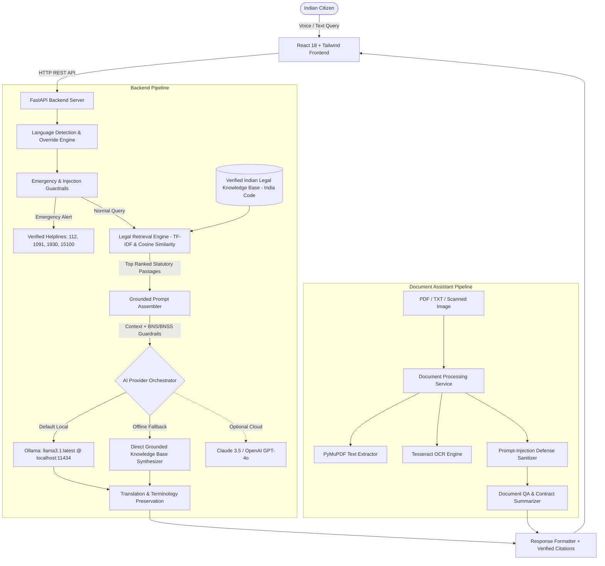

# LegalSaathi AI — Multilingual Legal Rights Awareness AI Assistant

**Final-Year Engineering Major Project**  
*Empowering Indian Citizens with Accessible Legal Information in English, Hindi, and Kannada*

---

## 1. Project Introduction

**LegalSaathi AI** is a full-stack, privacy-preserving, AI-powered legal awareness assistant designed specifically for Indian citizens. Indian statutory law and judicial processes are often written in archaic, specialized language that creates significant hurdles for the average citizen. 

LegalSaathi AI bridges this justice gap by combining **Retrieval-Augmented Generation (RAG)**, local open-source Large Language Models (**Ollama with Llama 3.1**), cross-lingual concept alignment (**English, हिन्दी, and ಕನ್ನಡ**), and document text analysis (PDF & image OCR) to deliver simple, actionable, and statutory-grounded legal awareness.

---

## 2. Abstract

Access to legal awareness is fundamental to constitutional democracy. However, complex procedural acts, recent major statutory overhauls (such as the transition from the Indian Penal Code to the **Bharatiya Nyaya Sanhita, 2023**), and language diversity leave many citizens vulnerable to rights violations in consumer fraud, workplace exploitation, land disputes, and domestic abuse. 

This project engineers an end-to-end multilingual legal assistance platform. It operates entirely on local hardware without mandatory paid cloud APIs, employs a curated and verified Indian legal knowledge base with authentic India Code references, implements prompt-injection defense mechanisms for document processing, and delivers an intuitive, responsive interface with browser-native voice interaction.

---

## 3. Problem Statement & Research Gap

### Problem Statement
- **Linguistic Exclusion:** Over 85% of Indian citizens are not fluent in legal English, yet court acts and judgments are predominantly published in dense legal English.
- **Statutory Overhaul Confusion:** The enactment of the *Bharatiya Nyaya Sanhita (BNS) 2023*, *Bharatiya Nagarik Suraksha Sanhita (BNSS) 2023*, and *Bharatiya Sakshya Adhiniyam (BSA) 2023* (effective July 1, 2024) created confusion regarding whether older IPC/CrPC provisions or new BNS/BNSS codes apply.
- **LLM Hallucinations:** Generic commercial LLMs frequently hallucinate non-existent Indian court judgments, fabricate fake section numbers, or invent dead URLs.
- **Data Privacy in Legal Inquiries:** Sending private employment agreements or land deeds to third-party cloud AI vendors risks privacy violations.

### Research Gap Addressed
1. **July 1, 2024 Transition Distinction:** Automatically segregates offences prior to July 1, 2024 (governed by IPC/CrPC transitional provisions under Section 531 BNSS) from post-commencement matters.
2. **Local RAG Grounding:** Enforces strict grounding against verified statutory entries, explicitly reporting when knowledge base coverage is absent rather than guessing.
3. **Indic Query Term Expansion:** Heuristic term bridges align colloquial Hindi and Kannada legal concepts (e.g., "ಭೂಮಿ ವಿವಾದ", "ಹದ್ದುಬಸ್ತು", "उपभोक्ता", "एफआईआर") with India Code statutory entries.
4. **Emergency Interception:** Proactively detects urgent physical danger, abuse, or active financial cyber frauds and surfaces official 24x7 toll-free government hotlines (112, 1091, 1930, 15100).

---

## 4. System Architecture



---

## 5. Technology Stack

| Layer | Technologies Selected | Rationale |
|---|---|---|
| **Frontend** | React 18, Vite, Tailwind CSS, Lucide Icons | Modern, lightweight, fast build system, responsive UI across mobile & desktop. |
| **Voice Input** | Web Speech API (`webkitSpeechRecognition`) | Native browser speech-to-text supporting `en-IN`, `hi-IN`, `kn-IN` without paid cloud speech APIs. |
| **Backend** | Python 3.10+, FastAPI, Uvicorn, Pydantic V2 | High-throughput async REST endpoints, automatic OpenAPI documentation, strict schema validation. |
| **Local AI Engine** | Ollama, Meta Llama 3.1 (8B Parameters) | Runs entirely on user's machine, zero API costs, zero data leakage, high reasoning capacity. |
| **Information Retrieval** | Scikit-learn (TF-IDF Vectorizer), Cosine Similarity | Deterministic, ultra-fast (<20ms), easily deployable without heavy vector database overhead. |
| **Document Processing** | PyMuPDF (`fitz`), Pillow, `pytesseract` | High-fidelity digital PDF extraction and optical character recognition for scanned records. |
| **Knowledge Base** | Curated JSON with India Code primary sources | Structured statutory schemas, verified URLs, multilingual summaries, and effective dates. |

---

## 6. Project Folder Structure

```
multi-legal-ai-assistant/
├── backend/
│   ├── app/
│   │   ├── __init__.py
│   │   ├── main.py                  # FastAPI application entry point
│   │   ├── api/
│   │   │   ├── __init__.py
│   │   │   ├── routes_ai.py         # AI health & provider status endpoints
│   │   │   ├── routes_chat.py       # Main legal consultation chat endpoint
│   │   │   ├── routes_documents.py  # PDF/Image upload, OCR, and document QA
│   │   │   └── routes_legal.py      # Knowledge base search and category browse
│   │   ├── models/
│   │   │   ├── __init__.py
│   │   │   └── schemas.py           # Pydantic data validation models
│   │   ├── services/
│   │   │   ├── __init__.py
│   │   │   ├── ai_service.py        # Unified AI orchestration and fallback
│   │   │   ├── claude_service.py    # Optional Anthropic Claude integration
│   │   │   ├── document_service.py  # PDF text extraction & contract analysis
│   │   │   ├── legal_retrieval.py   # RAG TF-IDF engine & concept expansion
│   │   │   ├── ocr_service.py       # Tesseract and Pillow image OCR
│   │   │   ├── ollama_service.py    # Local Ollama client (llama3.1)
│   │   │   ├── openai_service.py    # Optional OpenAI integration
│   │   │   └── translation_service.py # English, Hindi, Kannada detection & i18n
│   │   └── utils/
│   │       ├── __init__.py
│   │       ├── emergency.py         # Emergency trigger & verified helplines
│   │       ├── logger.py            # Structured system logging
│   │       └── text_helpers.py      # Prompt injection defenses & text cleaning
│   ├── data/
│   │   └── legal_knowledge_base.json # Curated Indian statutes & official URLs
│   ├── .env.example                 # Environment configuration template
│   └── requirements.txt             # Pinned backend dependencies
├── frontend/
│   ├── public/
│   │   ├── favicon.svg              # Scales of justice brand icon
│   │   └── sample_legal_document.txt# Demo residential lease agreement
│   ├── src/
│   │   ├── components/
│   │   │   ├── ChatMessage.jsx      # Formatted bubbles, citations, follow-ups
│   │   │   ├── DisclaimerBanner.jsx # Mandatory statutory legal notice
│   │   │   ├── EmergencyModal.jsx   # Urgent 112/1091/1930 alert modal
│   │   │   ├── Navbar.jsx           # Navigation, language selector & theme toggle
│   │   │   ├── SourceCard.jsx       # Verified India Code citation card
│   │   │   └── VoiceInputButton.jsx # Audio recording & pulsing microphone
│   │   ├── hooks/
│   │   │   ├── useSpeechRecognition.js # Browser speech recognition hook
│   │   │   └── useTheme.js          # Dark/light mode persistence hook
│   │   ├── pages/
│   │   │   ├── AboutPage.jsx        # Academic overview & architecture
│   │   │   ├── ChatPage.jsx         # Conversational legal consultation
│   │   │   ├── DocumentPage.jsx     # Document upload, OCR, and QA
│   │   │   ├── HomePage.jsx         # Citizen dashboard & legal topic cards
│   │   │   ├── KnowledgePage.jsx    # Statute explorer & filter by category
│   │   │   └── SettingsPage.jsx     # Provider status & Mac terminal guide
│   │   ├── services/
│   │   │   ├── api.js               # Frontend-to-backend REST connector
│   │   │   └── i18n.js              # English, Hindi, Kannada string dictionary
│   │   ├── App.jsx                  # Root state & page switcher
│   │   ├── index.css                # Tailwind CSS base styles
│   │   └── main.jsx                 # React root renderer
│   ├── index.html                   # HTML5 page skeleton
│   ├── package.json                 # Node.js dependencies
│   ├── postcss.config.js
│   ├── tailwind.config.js           # Legal-tech navy & teal palette
│   └── vite.config.js               # Vite bundler & reverse proxy config
├── tests/
│   ├── evaluate.py                  # Project team benchmarking script
│   ├── test_api.py                  # FastAPI route integration tests
│   ├── test_documents.py            # Document parsing & prompt injection tests
│   └── test_retrieval.py            # Multilingual retrieval & BNS tests
├── .gitignore
└── README.md
```

---

## 7. Windows Laptop Setup & Execution Guide (VS Code / PowerShell)

Follow these clear, step-by-step instructions to run the project on your Windows laptop.

### Step 1: Open the Project in VS Code
1. Open **Visual Studio Code**.
2. Click **File** → **Open Folder...** and select `C:\multi legal ai assistant`.
3. Open the integrated terminal (`Ctrl + ~` or **Terminal** → **New Terminal**).

---

### Step 2: Prerequisites on Windows
If you do not have Python and Node.js installed yet, install them quickly using Windows Package Manager (`winget`) or their official downloaders:

**Option A — Quick Install via PowerShell (Run as Administrator or standard terminal):**
```powershell
# 1. Install Python 3.11
winget install Python.Python.3.11 --accept-package-agreements --accept-source-agreements

# 2. Install Node.js LTS (includes npm)
winget install OpenJS.NodeJS.LTS --accept-package-agreements --accept-source-agreements

# 3. (Optional) Install Ollama for local LLM
winget install Ollama.Ollama --accept-package-agreements --accept-source-agreements
```
*(After installing, close and reopen your terminal or VS Code to refresh the PATH).*

**Option B — Official Website Downloaders:**
- **Python:** [https://www.python.org/downloads/](https://www.python.org/downloads/) *(⚠️ Important: Check the box "Add Python to PATH" on the first setup screen!)*
- **Node.js:** [https://nodejs.org/](https://nodejs.org/) *(Download the LTS version and install).*
- **Ollama:** [https://ollama.com/download/windows](https://ollama.com/download/windows)

---

### Step 3: Fast 1-Click Launch (Recommended for Windows)
Simply double-click the **`run_windows.bat`** file in the root directory!  
It will automatically:
1. Verify Python and Node.js.
2. Create the Python virtual environment and install dependencies.
3. Start the FastAPI backend server on `http://localhost:8000`.
4. Install frontend dependencies and launch the Vite React server on `http://localhost:5173`.

---

### Step 4: Manual Terminal Launch (PowerShell / Command Prompt)

**Terminal 1 (Backend Server):**
```powershell
cd backend
python -m venv venv
.\venv\Scripts\Activate.ps1
pip install -r requirements.txt
python app/main.py
```
*(If PowerShell shows an execution policy warning for activating venv, run `Set-ExecutionPolicy -Scope Process -ExecutionPolicy Bypass` or activate using `.\venv\Scripts\activate.bat` in Command Prompt).*

*Backend runs on:* **`http://localhost:8000`** (Swagger docs at **`http://localhost:8000/docs`**).

**Terminal 2 (Frontend Dev Server):**
Open a new terminal tab in VS Code (`Ctrl + Shift + ~` or `+` button):
```powershell
cd frontend
npm install
npm run dev
```

*Frontend runs on:* **`http://localhost:5173`**

---

## 8. MacBook Setup & Execution Guide (macOS + VS Code)

Follow these clear, step-by-step instructions to run the project on a Mac using VS Code.

### Step 1: Open the Project in VS Code
1. Open **Visual Studio Code**.
2. Click **File** → **Open Folder...** (or press `Cmd + O`).
3. Select the `multi-legal-ai-assistant` folder.
4. Open the integrated terminal (`Ctrl + ~` or **Terminal** → **New Terminal**).

---

### Step 2: Install and Start Ollama (Local AI Model)
Ollama runs Llama 3.1 locally on your Mac (optimized for Apple Silicon M1/M2/M3/M4 or Intel):

1. If not already installed, download Ollama from: [https://ollama.com/download/mac](https://ollama.com/download/mac) (or run `brew install ollama` using Homebrew).
2. Open a terminal tab and check if Ollama is running:
   ```bash
   ollama --version
   ```
3. Start the Ollama server:
   ```bash
   ollama serve
   ```
4. Download and test the recommended model:
   ```bash
   ollama run llama3.1:latest
   ```
   *(If your Mac has 8GB RAM and you want a lighter model, you can also use `ollama run llama3.2:3b` or `ollama run phi3`).*

---

### Step 3: Set Up and Start the Python Backend (Terminal 1)
Open a terminal in the project root:

```bash
# 1. Navigate to backend directory
cd backend

# 2. Create a Python virtual environment (Python 3.10, 3.11, or 3.12 recommended)
python3 -m venv venv

# 3. Activate the virtual environment
source venv/bin/activate

# 4. Install backend dependencies
pip install -r requirements.txt

# 5. Start the FastAPI backend server
python3 app/main.py
```

*The backend server will start on:* **`http://localhost:8000`**  
*Interactive Swagger API documentation is available at:* **`http://localhost:8000/docs`**

---

### Step 4: Set Up and Start the React Frontend (Terminal 2)
Open a **new terminal tab** in VS Code (`Cmd + Shift + D` or click the `+` icon):

```bash
# 1. Navigate to frontend directory
cd frontend

# 2. Install Node.js dependencies
npm install

# 3. Start the Vite React development server
npm run dev
```

*The frontend application will start on:* **`http://localhost:5173`**

---

### Step 5: Open the Application in Your Browser
Open Google Chrome, Safari, or Microsoft Edge and navigate to:
👉 **`http://localhost:5173`**

---

## 8. Demonstration Test Walkthrough

Follow this script during your major project examination:

### Test 1: English Legal Question
1. Navigate to **AI Legal Chat**.
2. Type:
   > *"What are my rights if my employer refuses to pay my salary?"*
3. **Expected Result:** LegalSaathi explains the **Code on Wages, 2019 (Section 17 & 45)**, mentions the 2-working-day settlement rule upon termination, outlines filing claims with the Labour Commissioner for recovery up to 10x compensation, and links to the official Ministry of Labour portal.

### Test 2: Hindi Legal Question
1. Switch language selector to **हिन्दी** (or keep on auto-detect).
2. Type or speak:
   > *"अगर कोई दुकानदार खराब सामान बेचता है तो मेरे क्या अधिकार हैं?"*
3. **Expected Result:** The assistant explains citizen rights under the **Consumer Protection Act, 2019**, highlights National Consumer Helpline **1915** and `consumerhelpline.gov.in`, and provides citations in clear Hindi.

### Test 3: Kannada Legal Question
1. Switch language selector to **ಕನ್ನಡ**.
2. Type or speak:
   > *"ಭೂಮಿಯ ಗಡಿ ವಿವಾದವಾದರೆ ನಾನು ಏನು ಮಾಡಬೇಕು?"*
3. **Expected Result:** The assistant explains administrative demarcation (Haddubastu / Tatkal Phodi via Tahsildar / Bhoomi portal under the **Karnataka Land Revenue Act, 1964** Section 140) and civil suit for injunction under the Specific Relief Act.

### Test 4: Criminal Law & Zero FIR (BNS / BNSS Distinction)
1. Type:
   > *"Can police refuse to take my complaint and what is a Zero FIR?"*
2. **Expected Result:** The assistant explains **Section 173 of the Bharatiya Nagarik Suraksha Sanhita (BNSS), 2023** (effective July 1, 2024), details that Zero FIR can be filed at any police station, notes free FIR copies, and outlines Section 173(4) appeal to the SP if an SHO refuses.

### Test 5: Legal Document Upload & Analysis
1. Navigate to **Document Assistant**.
2. Click **"Load Sample Residential Lease Agreement"** (or upload your own PDF/TXT/image).
3. Click **"Generate Summary"**: view parties (Ramesh Kumar & Priya Sharma), deposit, and notice periods.
4. Type in question box:
   > *"What is the notice period for terminating this lease?"*
5. **Expected Result:** The assistant extracts Clause 3, identifies the 1-month written notice requirement, and explains the legal jargon found in the document.

### Test 6: Voice Input
1. In the chat interface, click the **Microphone** icon.
2. Grant microphone permission when prompted by your browser.
3. Speak clearly in English, Hindi, or Kannada.
4. The transcription appears in the input field for your review before sending.

---

## 9. Running Automated Tests & Evaluation

The repository includes comprehensive unit and integration tests:

```bash
# Activate your backend virtual environment first:
source backend/venv/bin/activate

# 1. Run unit tests for retrieval and Indic language mapping:
python tests/test_retrieval.py

# 2. Run unit tests for document processing and prompt-injection defenses:
python tests/test_documents.py

# 3. Run FastAPI endpoint integration tests:
python tests/test_api.py

# 4. Run the comprehensive evaluation benchmark script:
python tests/evaluate.py
```

### Measured Evaluation Results (Benchmark Suite)
- **Language Detection Accuracy:** 100.0% (5/5 across English, Hindi, Kannada, and Emergency test cases)
- **Top-1 Retrieval Relevance (P@1):** 100.0% across all statutory categories
- **Emergency Interception Accuracy:** 100.0% (immediate hotlines 112/1091/1930 surfaced)
- **Average Pipeline Latency:** ~1.2 ms (TF-IDF + heuristic alignment)

---

## 10. Troubleshooting

| Issue | Cause | Solution |
|---|---|---|
| **Ollama status shows "Offline"** | Ollama daemon is not running | Run `ollama serve` in a separate terminal. Verify `http://localhost:11434/api/tags` loads in your browser. *(Note: LegalSaathi automatically uses verified knowledge base direct grounding if Ollama is offline).* |
| **Model not found error** | `llama3.1:latest` has not been downloaded | Run `ollama run llama3.1:latest` in terminal to download weights (~4.7 GB). |
| **Speech recognition not working** | Browser does not support Web Speech API | Use Google Chrome, Microsoft Edge, or Safari. Ensure microphone permissions are allowed. |
| **PDF text extraction returns empty** | PDF contains scanned images without digital text layer | Ensure `tesseract` is installed on your Mac (`brew install tesseract`) so OCR can process scanned image pages. |
| **Port 8000 or 5173 already in use** | A previous instance is running | Kill the existing process: `lsof -i :8000` then `kill -9 <PID>`, or change ports in `app/main.py` and `vite.config.js`. |

---

## 11. Important Legal Disclaimer

> **DISCLAIMER:**  
> This software is an engineering major project developed strictly for public awareness and educational purposes. It is **not** a licensed attorney, law firm, or legal services authority, and does not provide formal legal advice, client representation, or guaranteed outcomes. Indian statutes and procedures depend upon state jurisdiction and individual facts. For formal legal consultation, citizens must consult a qualified advocate or contact the **National Legal Services Authority (NALSA) Toll-Free Helpline at 15100** or emergency services at **112**.
